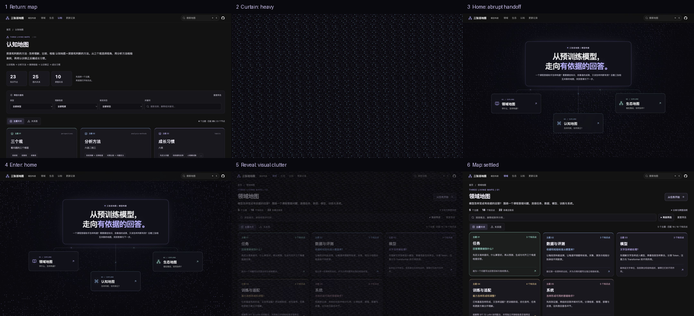

# 像素帷幕转场设计评审

本轮仅评审，不修改产品代码。以初学者在首页与地图之间往返为任务，主要检查运动连续性、视觉协调和操作负担。评审范围为当前本地生产预览的电脑端 1440×900；使用本轮新采集的截图，未使用之前交付动图作证据。

## 实看流程

| 步骤 | 当前画面 | 状态与判断 |
|---|---|---|
| 1 | 认知地图，点击首页面包屑 | 入口正常、目标明确。 |
| 2 | 返回中的全屏像素帷幕 | 遮挡过重，导航和旧页面参照物全部消失。 |
| 3 | 回到已展开主页 | 可继续操作；帷幕与主页自由流动的像素纹理衔接偏硬。 |
| 4 | 首页，点击领域地图卡片 | 入口正常；没有把所点击卡片的位置延续到下一画面。 |
| 5 | 遮幕退去，正文与像素重叠 | 过渡期亮点抢占视觉注意力，文字已经出现但尚不适合阅读。 |
| 6 | 领域地图稳定 | 正文恢复可读；视觉上像覆盖层撤掉，缺少明确的抵达动作。 |

## 主要批评

1. **页面关系被整屏遮幕切断。** 步骤 2、5 中，卡片、标题、导航全部消失。点击从哪个入口发生、将进入哪个地图，没有连续的视觉对象说明；单独一层效果承担了过多转场工作。优先保留导航，并把点击入口或目标标题作为连续参照。
2. **背景和帷幕的纹理像两套系统。** 主页像素有疏密、暗区、流动方向；帷幕突然变为密集、均匀的方格。相近色相无法弥补排列、密度和空间层次的突变。建议从现有背景场轻微变化，不另铺一整张发光点阵。
3. **慢下来以后，三段式停顿更明显。** 本轮进入/返回仍表现为旧页面淡下去、点阵占满屏、目标页面再显现。当前固定覆盖 450ms、揭示 600ms，在熟悉的返回操作上显得隆重。可以减少全遮挡时间，让旧内容退出与新内容出现重叠，进入约 500—650ms、返回约 250—350ms 作为下一轮验证起点。
4. **局部聚散缺少与导航有关的方向。** 少量位移主要发生在同一屏幕位置附近，视觉上更容易读成一张网格明暗变化，无法解释为“进入所点地图”。建议将变化局限在入口附近，并以入口位置决定轻微的方向变化；不需要中心爆发。
5. **退场抢走正文的注意力。** 步骤 5 的文字、卡片、导航已经出现，点阵仍覆盖其上。背景、过场和内容暂时争夺前景，画面显得脏。建议在正文开始显现前收掉最亮像素，将少量过渡细节留在外围。
6. **进入和返回的视觉分量接近，缺少层级。** 返回是回到熟悉的索引，也播放完整遮幕，重复使用容易产生“每次都播片头”的感觉。返回应明显更轻、更短，并直接提示原入口的位置。

## 保留与优先级

- 保留现有黑紫及三色强调，整体色相没有明显冲突；入口和到达后的页面可正常辨认。
- 第一优先级：保留页面参照、减少全屏遮挡、减轻返回；其次才微调粒子运动曲线和亮度。
- 亮点覆盖正文会增加视觉辨认负担。截图不能证明实际掉帧、光敏风险阈值或屏幕阅读器体验；本轮没有进行帧率/设备性能测量、减少动态效果或辅助技术复测，也不作完整无障碍合规结论。
- 原始截图及 enter-times.json、return-times.json 位于同目录。采样时间包含截图/工具延迟，仅用于定位画面，不能当作网页帧率。评审图仅等比例缩小并排版，没有重绘画面。

下一步建议先试一版保留导航与入口参照、降低整屏遮挡的轻转场，再决定是否保留当前像素帷幕结构。
