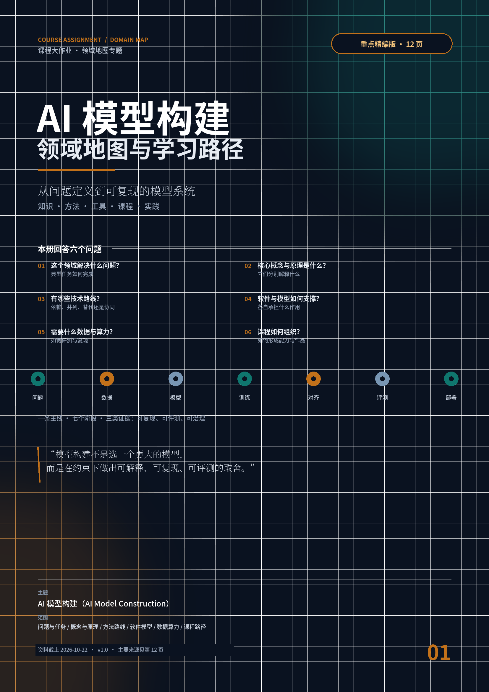
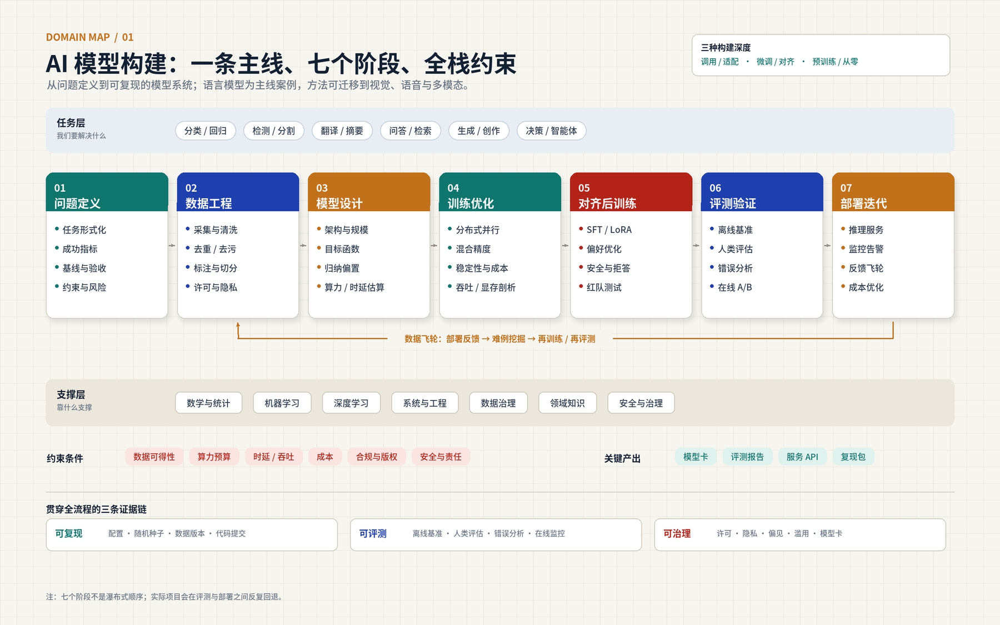
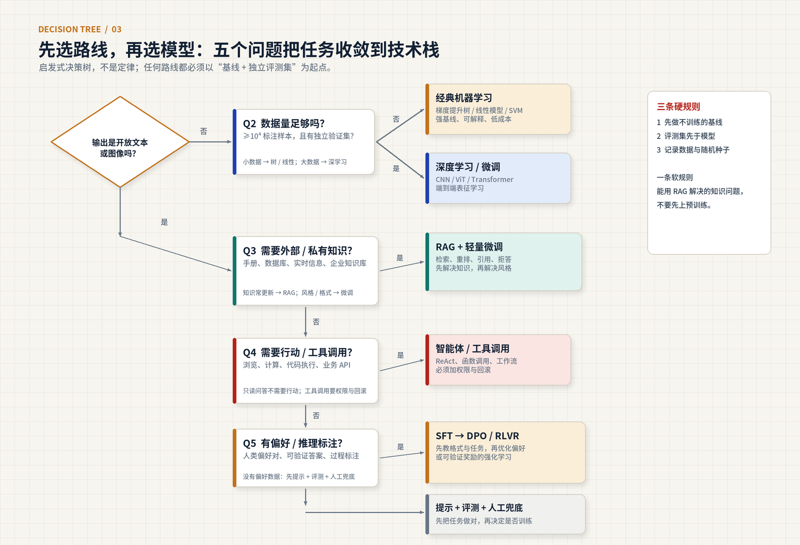
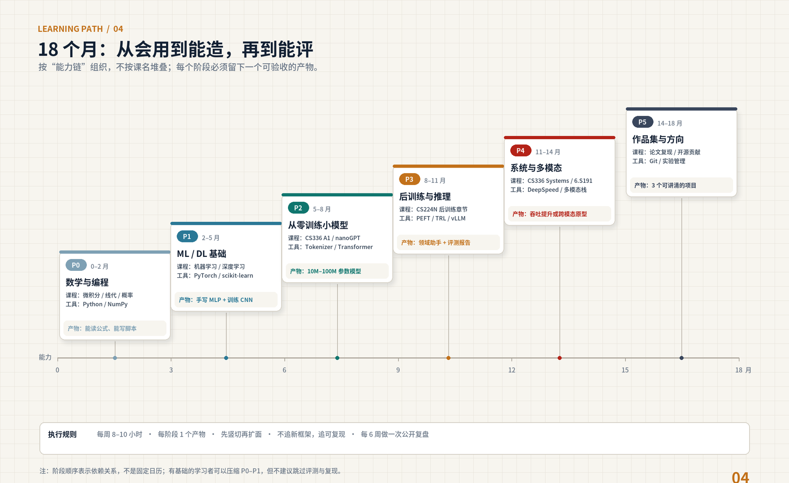

# 领域地图素材

## 00  /  一页纸结论

对应作业要求：领域地图总览 + 核心判断

一句话 AI 模型构建，是在数据、算力、时延、成本、合规与安全的约束下，把问题变成可复现、可评测、可部署的模型系统。模型只是链条中的一环；真正的分水岭是数据、目标、评测与系统。

图 1  领域地图：七个阶段、三层支撑、全栈约束

来源：作者绘制；综合 \[C01\]、\[C02\]、\[P05\]、\[P63\]。

### 五个判断

- 判断 1｜约束下的多目标优化。 能力、成本、可控性三角；更大不是默认答案。

- 判断 2｜瓶颈转向数据、目标、评测、系统。 架构积木趋稳，差异在数据与后训练。

- 判断 3｜工具链分层。 框架/训练/微调/推理/应用各司其职。

- 判断 4｜课程按能力链组织。 不按课名堆叠，用项目验收。

- 判断 5｜可复现性是分水岭。 配置、种子、数据版本、评测脚本缺一不可。

### 三种构建深度

| 深度 | 典型做法 | 数据/算力 | 适合谁 | 主要风险 |
| --- | --- | --- | --- | --- |
| 调用/适配 | 提示、RAG、工具调用、轻量微调 | 领域文档；单卡/API | 多数应用团队 | 把“集成”当“构建”；受基座限制 |
| 微调/对齐 | SFT、LoRA/QLoRA、DPO、蒸馏 | 千—十万样本；单卡—多卡 | 有领域数据与标注能力 | 过拟合、能力回退、评测不足 |
| 预训练/从零 | 数据清洗、Tokenizer、Transformer、分布式 | 十亿—万亿 token；多机多卡 | 研究/头部企业/教学实验 | 成本高、周期长、系统风险大 |

## 01  /  问题与任务

对应作业要求 1：主要问题与典型任务；一个典型任务如何完成

### 五类问题

| 类型 | 一句话定义 | 输入 → 输出 | 主指标 | 典型任务 |
| --- | --- | --- | --- | --- |
| 预测 | 从输入预测标签/数值/结构 | 图/文/表 → 类别、数值、框、掩码 | 准确率、F1、mAP、IoU | 分类、检测、分割、评分、诊断 |
| 生成 | 在条件下产生新样本 | 提示/图/音 → 文本、图像、音频、代码 | 困惑度、FID、人工偏好、通过率 | 翻译、摘要、对话、文生图、代码 |
| 表征 | 把样本映射为可比较向量 | 文/图/行为 → 向量 | Recall@k、NDCG、线性探测 | 检索、推荐、聚类、去重、RAG 召回 |
| 决策 | 在环境中选动作最大化长期回报 | 状态 → 动作/策略 | 回报、成功率、样本效率 | 机器人、游戏、调度、智能体 |
| 对齐 | 让行为符合人类偏好与规范 | 指令/对话 → 回复/拒答/澄清 | 有用性、诚实性、无害性、胜率 | 指令跟随、安全、价值观校准 |

### 六个典型任务卡

| 任务 | 输入 → 输出 | 主指标 | 强基线 | 最常见坑 |
| --- | --- | --- | --- | --- |
| 图像分类 | 图像 → 类别 | Top-1/5、混淆矩阵、校准 | ResNet / ViT 微调 | 类别不平衡；同源泄漏；只看总体 |
| 目标检测/分割 | 图像 → 框/掩码 | mAP、IoU、小目标召回 | YOLO/Faster R-CNN、U-Net | 标注不一致；后处理敏感 |
| 文本分类/抽取 | 文本 → 标签/实体/关系 | F1、精确/召回、一致性 | TF-IDF+线性、BERT 微调 | 标签定义模糊；边界不一致 |
| 翻译/摘要 | 源文本 → 目标文本 | BLEU/COMET、ROUGE、人评 | Transformer、LLM few-shot | 术语不一致；幻觉；指标与人类不符 |
| 检索/RAG | 问题 → 片段+答案+引用 | Recall@k、正确率、引用准确率 | BM25、embedding+ANN | 切块不当；召回与生成脱节 |
| 代码生成 | 描述/上下文 → 代码 | pass@k、编译率、测试通过率 | 代码 LLM、仓库级微调 | 训练泄漏；只测短函数；忽略许可 |

### 一个典型任务如何完成：领域文档问答

1. 任务卡：使用者、输入、输出、成功标准、约束、基线、失败代价。

2. 数据：PDF 解析保留页码/章节；按语义切块 300—600 字；300—500 条真实问答；构造“无答案”负样本。

3. 基线：BM25+模板；闭卷 LLM；RAG（embedding+重排+LLM）。

4. 路线：知识型错误优先改检索；风格/格式错误再考虑 LoRA。

5. 评测：检索 Recall@5；答案正确率；引用准确率；拒答率；P95 时延。

6. 部署：vLLM/内部服务；缓存；日志；每周失败案例归类，进入数据/检索/提示/微调队列。

任务卡的价值 不是“写清楚”，而是“逼出取舍”。当“引用准确率 ≥ 90%”与“P95 ≤ 4 秒”冲突时，才会认真考虑切块、重排、缓存与并行。

## 02  /  概念与公式

对应作业要求 2：核心概念与原理；它们分别解释什么

### 十个必须能解释的概念

| 概念 | 一句话解释 | 它解释什么 | 常见误解 |
| --- | --- | --- | --- |
| 参数/张量 | 可学习数值；多维数组 | 容量、GPU 并行 | 参数越多越好；张量=矩阵 |
| Token/嵌入 | 文本最小单位；离散对象→连续向量 | 上下文、费用、语义检索 | token=字/词；维度越高越好 |
| 注意力 | 按相关性聚合其他位置信息 | 长距离依赖、并行、可解释 | 注意力权重=因果解释 |
| Transformer | 注意力+前馈层的通用骨架 | 现代大模型结构 | 只能做 NLP |
| MoE | 每 token 只激活部分专家 | 大总参数、低计算 | MoE 一定更便宜 |
| 损失/交叉熵 | 衡量预测与目标的差距 | 模型在优化什么 | loss 低=任务好 |
| 反向传播 | 链式法则求梯度 | 深度学习为何可训练 | 它=优化算法 |
| AdamW | 自适应学习率+解耦权重衰减 | 大模型训练默认优化器 | 不用调学习率 |
| 缩放规律 | 损失随模型/数据/算力幂律下降 | 预算如何分配 | 只要堆参数 |
| 量化/模型卡 | 低比特表示；记录用途/限制 | 降本、透明度 | 量化必掉点；模型卡=形式 |

### 四个关键公式

| 公式 | 怎么读 | 什么时候用 |
| --- | --- | --- |
| 交叉熵 L = −(1/N) Σ log p(y∣x) | 正确类概率越高，损失越小；衡量“惊讶程度” | 分类、语言建模 |
| 注意力 softmax(QKᵀ/√d\_k)V | Q 与 K 算相关性，softmax 归一化，对 V 加权 | 序列/视觉/多模态 |
| LoRA W' = W + (α/r)BA | 冻结 W，只训练低秩补丁；r 控制容量 | 单卡领域适配 |
| 缩放 L = E + AN^(−α) + BD^(−β) | 模型/数据都能降损失，但边际递减；Chinchilla 约 20 token/参数 | 预训练预算分配 |

### 五个常见误区

- 参数越多越好：固定算力下参数与数据要平衡；推理成本常被忽略。

- 训练 loss 低=模型好：可能过拟合、泄漏或评测污染。

- 微调一定优于 RAG：知识型问题优先检索；风格/格式再微调。

- benchmark 高分=真实能力强：污染、饱和、提示敏感、领域错位。

- Agent=LLM+工具：可靠性、权限、错误传播、回滚才是难点。

## 03  /  方法与路线

对应作业要求 2：有哪些解决方法；彼此依赖、并列、替代还是协同

### 八条路线

| 路线 | 核心思想 | 何时用 | 主要局限 |
| --- | --- | --- | --- |
| 经典监督学习 | 人工特征+统计模型 | 表格、小数据、要可解释 | 非结构化数据特征成本高 |
| 深度学习端到端 | 多层网络学表征 | 图/文/音，数据足够 | 数据/算力需求高，难解释 |
| 自监督预训练+微调 | 无标注预训练，标注微调 | 标注少、无标注多 | 预训练贵，微调会遗忘 |
| 提示/上下文学习 | 不改参数，改输入 | 快速验证、任务多样 | 受上下文限制，提示敏感 |
| 参数高效微调 | 冻结主体，训练少量参数 | 单卡、领域风格/格式 | 容量有限，秩/模块敏感 |
| 对齐训练 | 偏好/规则/可验证奖励 | 有用、诚实、无害 | 数据贵，奖励黑客，难评 |
| RAG | 先检索，再生成 | 知识更新、私有、需引用 | 检索决定上限，多跳弱 |
| 智能体/工具 | 规划+调用工具+执行 | 需行动、计算、实时信息 | 错误传播，权限/评测复杂 |

### 路线关系：不要把它们当互斥选项

| A | B | 关系 | 说明 |
| --- | --- | --- | --- |
| 预训练 | 微调/对齐 | 依赖 | 底座→行为；没有预训练就没有可微调的基础模型 |
| 全参微调 | LoRA/QLoRA | 替代/互补 | 资源足/要最大容量用全参；单卡/多任务用 LoRA |
| RAG | 长上下文 | 部分替代/互补 | 少量长文档用长上下文；大规模/可更新/需引用用 RAG |
| RAG | 微调 | 互补 | RAG 管“知道什么”，微调管“怎么说/怎么做” |
| RLHF | DPO | 替代 | 都优化偏好；RLHF 更灵活，DPO 更简单稳定 |
| 蒸馏 | 量化 | 协同 | 先迁能力到小模型，再降部署成本 |
| CNN | ViT | 替代/互补 | 小数据/边缘 CNN；大数据/多模态 ViT |
| Transformer | SSM/Mamba | 替代/互补 | 超长/流式 SSM；通用生态 Transformer |

图 2  技术路线选择的启发式决策树：任务形态→数据量→知识→行动→偏好

来源：作者绘制；综合 \[C01\]、\[C02\]、\[P23\]、\[P24\]。

### 五个场景的路线建议

| 场景 | 建议路线 | 关键理由 | 主要风险 |
| --- | --- | --- | --- |
| 小数据表格 | 梯度提升树/线性→深度（可选） | 强基线、可解释、快 | 过拟合、特征泄漏 |
| 中等数据图像 | 预训练 CNN/ViT 微调→蒸馏/量化 | 表征强、成本低 | 域偏移、长尾 |
| 企业文档问答 | RAG→重排→引用/拒答→LoRA（可选） | 可更新、可引用、便宜 | 切块/召回/引用错配 |
| 低时延边缘 | 蒸馏→量化→专用推理引擎 | 成本/时延优先 | 精度掉点、算子兼容 |
| 复杂推理 | SFT→RLVR/DPO→测试时计算 | 多步推理与验证 | 奖励黑客、评测泄漏 |

三条硬规则 先做不训练的基线；评测集先于模型；记录数据版本与随机种子。违反这三条，后面的“优化”都不可信。

## 04  /  工具与模型

对应作业要求 2：软件/模型能完成什么、依赖什么、对应哪些课程、哪里会失效

### 工具链六层

| 层 | 作用 | 代表工具 | 不该用它做什么 |
| --- | --- | --- | --- |
| L0 语言/数值 | 数据与计算 | Python、NumPy、pandas | 直接训练大模型 |
| L1 建模框架 | 张量、自动微分、网络层 | PyTorch、JAX、scikit-learn | 大规模分布式全部工程 |
| L2 数据/实验 | 数据、版本、追踪、标注 | HF Datasets、DVC、W&B、MLflow | 替代评测 |
| L3 训练/并行 | 单机/多机、显存优化 | Lightning、Accelerate、DeepSpeed、Megatron、FSDP | 直接面向业务 |
| L4 微调/对齐 | PEFT、偏好优化 | PEFT、TRL、Unsloth | 替代数据与评测 |
| L5 推理/部署 | 高吞吐、编译、量化 | vLLM、TensorRT-LLM、ONNX Runtime、Triton | 训练模型 |
| L6 应用/编排 | 检索、工具、界面 | LangChain、LlamaIndex、FAISS、Gradio、FastAPI | 替代底层能力 |

### 工具速查

| 工具 | 层 | 主要用途 | 前置知识 | 局限/替代 |
| --- | --- | --- | --- | --- |
| PyTorch | L1 | 张量、autograd、训练 | Python、反向传播 | 大并行需 FSDP/DeepSpeed |
| HF Transformers | L1/L4 | 加载/训练/推理预训练模型 | PyTorch、Transformer | 封装高，初学需懂训练循环 |
| PEFT | L4 | LoRA 等高效微调 | 微调、显存 | 容量有限；可全参 |
| TRL | L4 | SFT/DPO/GRPO | 对齐、RL 基础 | 配置复杂；可自写 |
| DeepSpeed | L3 | ZeRO、卸载、分布式 | 显存、通信 | 配置复杂；可 FSDP |
| Megatron-LM | L3 | TP/PP/SP/专家并行 | 分布式系统 | 门槛高；可 DeepSpeed |
| vLLM | L5 | 高吞吐推理 | 推理、KV cache | 自定义模型要适配 |
| TensorRT-LLM | L5 | NVIDIA 优化推理 | CUDA/TensorRT | 平台绑定 |
| LangChain | L6 | LLM 应用编排 | API、RAG | 抽象变化快 |
| FAISS | L6 | 向量检索 | ANN/向量 | 无分布式事务 |

### 一张“五联卡”：Transformer

| 维度 | 内容 |
| --- | --- |
| 能完成的任务 | 翻译、摘要、问答、对话、代码；视觉 patch、语音/多模态 token 序列 |
| 背后的概念 | 自注意力 Q/K/V、多头、位置编码、残差、LayerNorm、下一 token 预测 |
| 使用前要知道 | 线性代数/softmax、反向传播、PyTorch 张量与训练循环 |
| 对应课程/资源 | CS224N、CS336、MIT 6.7960；\[P01\]、\[B04\] |
| 适用/局限/替代 | 长序列、可并行时优先；长上下文二次复杂度；替代：CNN、RNN/SSM、稀疏注意力 |
| 最小上手 | 手写单头 attention → 堆 2 层 block → 小翻译/语言建模任务对比 RNN |

## 05  /  数据、算力与评测

对应作业要求 1：需要什么数据、评测、实验环境或硬件条件

### 数据生命周期

采集 → 解析 → 清洗 → 去重 → 过滤 → 去污染 → 切分 → 版本化。每一步都留“数据卡”：来源、许可、规模、时间、处理、切分、隐私、偏见、版本、已知问题。

### 常用数据与评测资源

| 资源 | 类型/规模 | 典型用途 | 注意 |
| --- | --- | --- | --- |
| Common Crawl | Web 抓取，PB 级原始数据 | 预训练起点 | 版权复杂，需清洗 |
| The Pile | 约 825GiB、22 子集 | 多领域预训练 | 子集许可不同 |
| C4 | 约 750GB 清洗英文网页 | 语言模型预训练 | 去重/去污染 |
| ImageNet | 约 128 万训练图、1000 类 | 图像分类 | 研究条款 |
| COCO | 约 33 万图、80 类 | 检测/分割/描述 | 标注/图像许可分开 |
| MMLU | 57 学科、约 1.5 万题 | 知识评测 | 污染/饱和 |
| GSM8K | 约 8.5k 数学题 | 推理评测 | 答案格式敏感 |
| HumanEval | 164 道 Python 题 | 代码评测 | 题目短、易泄漏 |
| MTEB | 数十个嵌入任务 | 检索/分类/聚类 | 语言/任务覆盖不均 |
| Chatbot Arena | 人类成对偏好 | 对话偏好 | 人群/提示偏差 |

### 评测的三个层次

| 层次 | 看什么 | 常用工具 | 局限 |
| --- | --- | --- | --- |
| 能力层 | 基准分数 | MMLU、GSM8K、HumanEval、MTEB | 污染、饱和、与真实任务脱节 |
| 任务层 | 你的真实指标 | 自建 100—1000 条测试集 | 成本高、样本小 |
| 体验层 | 有用/可信/可纠正 | 人类评估、A/B、访谈 | 主观、难复现 |

### 算力粗算

- 训练算力 C ≈ 6ND；N=7B、D=140B ≈ 5.9×10²¹ FLOPs，100 TFLOP/s 理论约 680 GPU 天。

- 训练显存：混合精度+Adam 约“每参数 16—20 字节”+激活；7B 仅状态就可能 >100GB，需分片/卸载。

- 推理：每 token 约 2N FLOPs；长上下文 KV cache 可能超过权重。

- 单卡 24GB：7B QLoRA、≤1B 从零训练、推理；7B 全参预训练不可行。

### 最小可行方案

- A 领域 LoRA：1×24GB，QLoRA，数千样本，1—2 周；产出适配器+评测报告+模型卡。

- B 从零小模型：10M—100M 参数，2—4 周；产出训练日志+样例+报告。

- C RAG 问答：1 周，推荐作为第一个项目；产出检索/答案评测+Demo。

## 06  /  课程、路径与培养方案

对应作业要求 3：培养要求→能力→课程→工具→实践；前置/核心/部分/实践/拓展

### 课程池（示例；具体以本校方案为准）

| 课程（示例） | 代表院校 | 在模型构建中的角色 | 标签 |
| --- | --- | --- | --- |
| 数学分析/微积分 | 清华、北大、浙大；MIT 18.01 | 损失、梯度、概率密度 | 前置基础 |
| 线性代数 | 清华、北大、浙大；MIT 18.06 | 张量、矩阵分解、注意力 | 前置基础 |
| 概率论与数理统计 | 清华、北大、浙大；Stanford CS109 | 分布、估计、评测置信 | 前置基础 |
| 程序设计/数据结构 | 清华、北大、浙大；CMU 15-122 | 代码、复杂度、数据管道 | 前置基础 |
| 最优化方法 | 清华、北大、浙大 | 收敛、梯度法、约束 | 核心覆盖 |
| 人工智能导论 | 清华、北大、浙大 | 领域全景与术语 | 核心覆盖 |
| 机器学习 | 清华、北大、浙大；CS229、10-701、CS189 | 监督/无监督、评估 | 核心覆盖 |
| 深度学习 | 清华、北大、浙大；6.7960、11-785、CS182 | MLP/CNN/RNN/Transformer | 核心覆盖 |
| 计算机视觉 | 清华、北大、浙大；CS231N | 检测/分割/生成/多模态 | 部分涉及 |
| 自然语言处理 | 清华、北大、浙大；CS224N | 词向量、注意力、预训练、后训练、RAG | 部分涉及 |
| 强化学习 | 清华、北大、浙大；CS285 | MDP、策略梯度、LLM RL | 部分涉及 |
| 深度学习系统 | CMU 10-414/714；CS336 systems | 内存、并行、编译、推理 | 实践应用 |
| 大语言模型从零构建 | Stanford CS336 | 数据→Tokenizer→模型→训练→评测 | 实践应用 |

### 18 个月路径

图 3  18 个月：从会用到能造，再到能评；每阶段一个可验收产物

来源：作者绘制；参考 \[C01\]、\[C02\]、\[C07\]、\[C08\]。

### 四个作品集项目

- 经典基线：表格数据端到端预测，证明会做基线、懂评估。

- 预训练微调：视觉/文本任务，证明会用预训练、会做错误分析。

- 从零小模型：10M—100M 参数语言模型，证明理解内部。

- RAG/领域助手：私有知识+引用+评测+服务，证明能把模型变成系统。

### 培养方案对接（三条链路）

| 取向 | 培养要求（参照） | 具体能力 | 课程内容 | 概念/工具 | 后续实践 |
| --- | --- | --- | --- | --- | --- |
| 科学家 | 识别/形式化问题；设计实验；学术沟通 | 提假设、做消融、写复现 | 机器学习、深度学习、最优化、方向课 | 偏差—方差、scaling law、PyTorch | 复现一篇论文+新实验+4 页报告 |
| 工程师 | 设计系统；构建数据/训练管道；优化性能 | 训练、部署、压测、回滚 | 深度学习系统、分布式、数据库/OS | FSDP/DeepSpeed、vLLM、W&B | 部署 RAG/微调服务+SLO 报告 |
| 设计/产品 | 发现需求；人机协同；伦理判断 | 访谈、原型、体验评估 | 人机交互、设计思维、AI 伦理 | 任务分析、引用/拒答、human-in-loop | 5 个用户访谈+可点击原型+评测 |

课程关联的底线 课程名必须来自真实培养方案；不确定的标“待核实”；未来课程只是学习入口，不能当成本课程先修要求。不要凭课名猜内容。

## 07  /  理解程度与待核实

对应作业要求 4：标明当前理解程度

### 五级量表

| 层级 | 名称 | 可观察证据 | 不能称为 |
| --- | --- | --- | --- |
| L0 | 未接触 | 说不出基本定义 | “了解” |
| L1 | 能复述 | 能解释概念、看懂教程 | “掌握” |
| L2 | 能解释 | 能说明为什么、何时失败、比较方案 | “精通” |
| L3 | 能复现 | 独立复现最小例子/论文实验，能修常见错误 | “会做研究” |
| L4 | 能改造 | 针对新任务改结构/目标/数据/系统，并用评测证明 | “专家” |
| L5 | 能创新/迁移 | 提出新问题/方法，或迁移到新领域并产出可复用成果 | “大师” |

### 关键节点自评（团队填写）

| 关键节点 | 建议目标 | 资料可支撑 | 当前（L0—L5） | 证据/下一步 |
| --- | --- | --- | --- | --- |
| 任务形式化与验收 | L3 | L3 |  | 写任务卡；找 1 个反例 |
| 数据清洗/去重/去污染 | L3 | L3 |  | 处理真实语料；报告重复率 |
| Transformer/注意力 | L4 | L3 |  | 手写 attention；训练小模型 |
| 训练循环/反向传播 | L4 | L3 |  | 从零写循环；过拟合小 batch |
| LoRA/QLoRA | L3 | L3 |  | 单卡微调 7B/8B；对比全参 |
| DPO/RLHF | L2 | L2 |  | 读论文；跑小型 DPO |
| 离线评测/错误分析 | L4 | L3 |  | 100 条评测集；混淆矩阵 |
| RAG/引用/拒答 | L3 | L3 |  | 领域问答；评估引用 |
| vLLM/量化/服务 | L3 | L3 |  | 部署 API；记录 P95 |
| 可复现/模型卡 | L3 | L3 |  | 写复现包+模型卡 |

填表示例 Transformer：目标 L4；资料可支撑 L3；团队当前 L3；证据：独立手写 attention，训练过 50M 参数模型，能定位 loss 异常。

### 待核实

- 本校课程名/学分/学期：教务处/学院培养方案、课程大纲；课名相似≠内容相同。

- 数据/模型许可：LICENSE、数据集页面、法务；商用与再分发限制。

- GPU/云预算：设备清单、云报价；决定可行方案。

- 评测集污染：n-gram/embedding 近似检查；分数是否可信。

## 08  /  十二周行动与主要来源

把地图变成行动；来源可核查

### 十二周（每周 8—10 小时）

| 阶段 | 周 | 目标 | 交付 |
| --- | --- | --- | --- |
| 打地基 | 1—2 | 任务卡、基线、50 条评测集、数据卡 | 任务卡+数据卡+评测集 v0 |
| 跑通 | 3—4 | 端到端 Demo、100 条评测、错误分类 | 可运行系统+评测报告 v1 |
| 改进 | 5—8 | 只改一个变量；消融；稳健性 | 对比实验+消融表 |
| 交付 | 9—12 | 服务化、压测、红队、模型卡、复现包 | API+报告+复现包 |

### 最终交付清单

- ☐ 代码可运行；☐ 数据卡/版本/切分；☐ 模型卡；☐ 评测集与错误分析；☐ 服务/演示；☐ README+复现包；☐ 红队/许可/回滚。

### 主要来源（节选）

\[C01\] Stanford University. CS336: Language Modeling from Scratch (Spring 2026). 课程网站, 2026. [https://cs336.stanford.edu/](https://cs336.stanford.edu/)

\[C02\] Stanford University. CS224N: Natural Language Processing with Deep Learning (Winter 2026). 课程网站, 2026. [https://web.stanford.edu/class/cs224n/](https://web.stanford.edu/class/cs224n/)

\[C07\] MIT. 6.S191: Introduction to Deep Learning (2026). 课程网站, 2026. [https://introtodeeplearning.com/](https://introtodeeplearning.com/)

\[C08\] MIT EECS. 6.7960: Deep Learning (Fall 2024). 课程网站, 2024. [https://phillipi.github.io/6.7960/](https://phillipi.github.io/6.7960/)

\[C10\] Carnegie Mellon University. 10-701: Introduction to Machine Learning. 2026–2027 Course Catalog, 2026. [https://coursecatalog.web.cmu.edu/search/?P=10-701](https://coursecatalog.web.cmu.edu/search/?P=10-701)

\[C13\] UC Berkeley EECS. CS 189: Introduction to Machine Learning. 课程目录, 2026. [https://www2.eecs.berkeley.edu/Courses/CS189/](https://www2.eecs.berkeley.edu/Courses/CS189/)

\[C15\] UC Berkeley. CS 185/285: Deep Reinforcement Learning. 课程网站, 2026. [https://rail.eecs.berkeley.edu/deeprlcourse/](https://rail.eecs.berkeley.edu/deeprlcourse/)

\[C16\] 清华大学. 清华大学人工智能班（智班）本科培养方案. 清华大学本科招生/培养方案公开文件, 2022. [https://www.tsinghua.edu.cn/jxjywj/bkzy2022/zxzy/29-3.pdf](https://www.tsinghua.edu.cn/jxjywj/bkzy2022/zxzy/29-3.pdf)

\[C17\] 北京大学. 北京大学本科培养方案（人工智能专业相关部分）. 北京大学教务部公开文件, 2023. [http://www.dean.pku.edu.cn/userfiles/upload/download/202309010917575972.pdf](http://www.dean.pku.edu.cn/userfiles/upload/download/202309010917575972.pdf)

\[C18\] 浙江大学. 人工智能（图灵班）专业培养方案（2020级）. 浙江大学计算机学院公开文件, 2020. [http://www.cs.zju.edu.cn/\_upload/article/files/b1/07/a409a90a493786ce1ff5c50a6469/2d3416cf-b6ae-4f55-883b-fc5cd1f1acfb.pdf](http://www.cs.zju.edu.cn/_upload/article/files/b1/07/a409a90a493786ce1ff5c50a6469/2d3416cf-b6ae-4f55-883b-fc5cd1f1acfb.pdf)

\[P01\] Vaswani, A. et al.. Attention Is All You Need. NeurIPS 2017, 2017. [https://arxiv.org/abs/1706.03762](https://arxiv.org/abs/1706.03762)

\[P03\] Brown, T. B. et al.. Language Models are Few-Shot Learners. NeurIPS 2020, 2020. [https://arxiv.org/abs/2005.14165](https://arxiv.org/abs/2005.14165)

\[P05\] Hoffmann, J. et al.. Training Compute-Optimal Large Language Models. NeurIPS 2022, 2022. [https://arxiv.org/abs/2203.15556](https://arxiv.org/abs/2203.15556)

\[P06\] Hu, E. J. et al.. LoRA: Low-Rank Adaptation of Large Language Models. ICLR 2022, 2022. [https://arxiv.org/abs/2106.09685](https://arxiv.org/abs/2106.09685)

\[P08\] Rafailov, R. et al.. Direct Preference Optimization: Your Language Model is Secretly a Reward Model. NeurIPS 2023, 2023. [https://arxiv.org/abs/2305.18290](https://arxiv.org/abs/2305.18290)

\[P09\] Ouyang, L. et al.. Training Language Models to Follow Instructions with Human Feedback. NeurIPS 2022, 2022. [https://arxiv.org/abs/2203.02155](https://arxiv.org/abs/2203.02155)

\[P16\] Grattafiori, A. et al.. The Llama 3 Herd of Models. arXiv, 2024. [https://arxiv.org/abs/2407.21783](https://arxiv.org/abs/2407.21783)

\[P19\] Ho, J.; Jain, A.; Abbeel, P.. Denoising Diffusion Probabilistic Models. NeurIPS 2020, 2020. [https://arxiv.org/abs/2006.11239](https://arxiv.org/abs/2006.11239)

\[P23\] Lewis, P. et al.. Retrieval-Augmented Generation for Knowledge-Intensive NLP Tasks. NeurIPS 2020, 2020. [https://arxiv.org/abs/2005.11401](https://arxiv.org/abs/2005.11401)

\[P26\] Liang, P. et al.. Holistic Evaluation of Language Models (HELM). TMLR 2023, 2022. [https://arxiv.org/abs/2211.09110](https://arxiv.org/abs/2211.09110)

\[P27\] Hendrycks, D. et al.. Measuring Massive Multitask Language Understanding (MMLU). ICLR 2021, 2021. [https://arxiv.org/abs/2009.03300](https://arxiv.org/abs/2009.03300)

\[P30\] Chen, M. et al.. Evaluating Large Language Models Trained on Code (HumanEval). arXiv, 2021. [https://arxiv.org/abs/2107.03374](https://arxiv.org/abs/2107.03374)

\[P46\] Mitchell, M. et al.. Model Cards for Model Reporting. FAT\* 2019, 2019. [https://arxiv.org/abs/1810.03993](https://arxiv.org/abs/1810.03993)

\[S01\] PyTorch. PyTorch Documentation. 官方文档, 2026. [https://pytorch.org/docs/stable/index.html](https://pytorch.org/docs/stable/index.html)

\[S02\] Hugging Face. Transformers Documentation. 官方文档, 2026. [https://huggingface.co/docs/transformers/index](https://huggingface.co/docs/transformers/index)

\[S06\] Microsoft. DeepSpeed. 官方文档, 2026. [https://www.deepspeed.ai/](https://www.deepspeed.ai/)

\[S08\] vLLM Project. vLLM Documentation. 官方文档, 2026. [https://docs.vllm.ai/](https://docs.vllm.ai/)

\[D03\] EleutherAI. The Pile. 官方网站, 2020. [https://pile.eleuther.ai/](https://pile.eleuther.ai/)

\[D06\] Stanford Vision Lab et al.. ImageNet. 官方网站, 2026. [https://www.image-net.org/](https://www.image-net.org/)

\[D13\] LMArena. Chatbot Arena. 官方网站, 2026. [https://lmarena.ai/](https://lmarena.ai/)

\[G01\] NIST. AI Risk Management Framework (AI RMF 1.0). NIST, 2023. [https://www.nist.gov/itl/ai-risk-management-framework](https://www.nist.gov/itl/ai-risk-management-framework)

完整 148 条来源、A/B/C 证据分级与访问日期见长版《AI 模型构建：领域地图、工具链与学习路径》附录 C。
