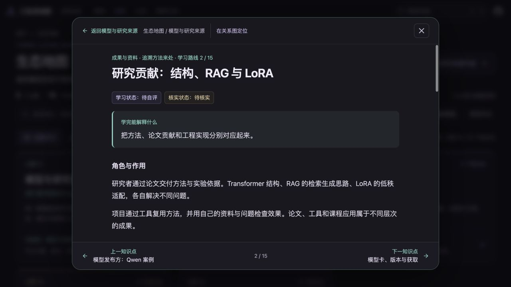
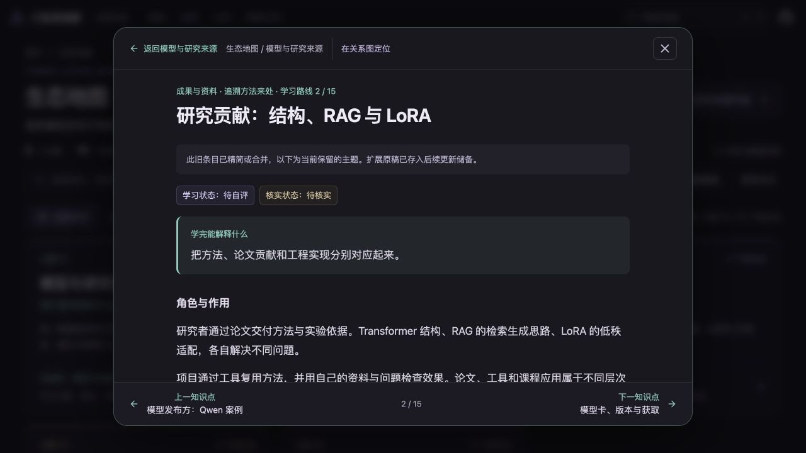
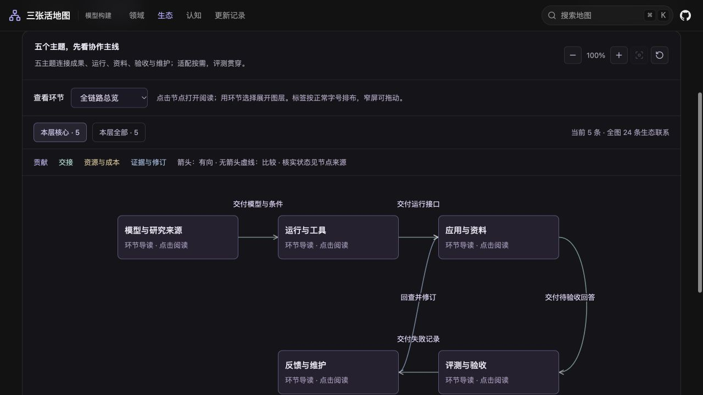
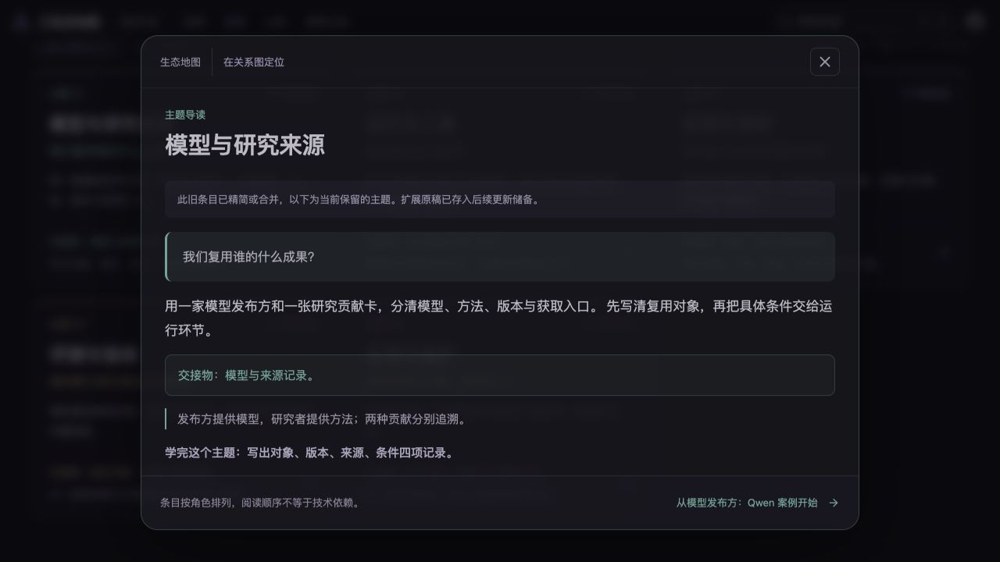

# 生态地图精简验收 · 2026-11-02

## 结果

- 7主题、47条目、62条本图关系 → 5主题、15条目、24条关系；每主题3条核心内容。
- 14个原条目保留重写，33个移出或合并，新增1张合并研究贡献卡。
- 原稿、关系、来源和逐项去向统一存于 `../future-updates/ecosystem-2026-11-02/`。对照修改前Git版本核验25份原始文件，全部一致。
- 35个旧节点或环节地址指向保留内容，10个旧分类入口继续有效；旧团队地址进入来源主题，不冒充其他团队。
- 7篇主题文章同步压缩；13个旧文章入口保留稳定ID和路径，转为简短迁移入口并退出全站搜索。
- 领域与认知结构保留，仅更新领域地图指向合并研究卡的目标。

## 自动检查

- 内容及类型检查通过：69个正文ID、38个来源锚点。
- 默认根路径生产构建、导出检查与69项测试通过。
- `/three_maps`子路径的最终生产构建、69项测试及导出检查通过：73个HTML，3,599个链接与资源。
- `git diff --check`通过。
- 构建保留依赖包的CSS highlight优化警告；未影响构建成功。

## 浏览器抽查

使用本机静态预览，1280×720。最终预览采用 `/three_maps` 前缀。

1. 总览显示5个主题、15条目、24关系；每主题3条目。
2. 从来源主题进入合并研究卡，正文、前后知识点和跨图来源可读。
3. 旧 `#node-lora-authors` 打开研究贡献卡并显示合并提示。
4. 关系图只展示5个主题及5条主线联系，展开后查看核心条目。
5. 子路径下旧 `#node-deepseek-team` 进入来源主题，首屏显示合并说明；已修复继承旧滚动位置的问题。

本次未提交或发布，没有新增模型实测、成员经历或真实访客反馈结论。浏览器抽查不等同于全量移动端、屏幕阅读器或网络可达性验证。
