# 人工智能教师视角审查

审查日期：2026-10-30。对象：当前工作区 website 的本地开发版本。浏览器视口：1280×720。方法：实际浏览、点击、滚动、关键词检索、截图，辅以当前教学数据及项目文档核对。未修改网站源代码，未发布网站。

## 总体判断

目前网站的资料组织与视觉包装，明显走在教学验证前面。它已经能够展示一套知识框架，但还没有充分证明：学生读完以后能够独立解释机制、完成操作，并用证据判断结果。

值得保留的是：三图职责有区分；节点写了学习目标；SFT 与 LoRA、检索失败与生成失败被分别讨论；教学示例没有冒充真实实验。以下批评针对实际教学效果和交付完整度，不否定这些基础。

## 审查路径与健康情况

| 步骤 | 实际操作 | 健康情况 | 截图 |
| --- | --- | --- | --- |
| 1 | 首次进入首页并展开地图 | 可操作；首访先付出一次额外点击，学习入口与预期产物不够具体 | 01、02 |
| 2 | 进入领域地图，展开训练主题，阅读 LoRA | 分类与目标清楚；机制演示和实际操作偏薄，长文受限于浮层 | 03、04、05 |
| 3 | 点击“在关系图定位”，关闭浮层看图 | 视图切换发生；浮层仍挡图，关闭后所选状态消失，按钮反馈不完整 | 06、07 |
| 4 | 进入生态地图，阅读 Qwen 团队 | 来源入口与历史边界清楚；模板、核对要求多，完整选型实例少 | 08、09 |
| 5 | 进入认知地图，阅读损失案例 | 方法分类清楚；案例主要为预写结论与假想回答的文本核对 | 10、11 |
| 6 | 展开理解检查答案 | 展开正常；没有先作答、针对错误的反馈或迁移验证 | 12 |
| 7 | 全站搜索 LoRA | 有结果；精确条目优先级差，首屏出现原始公式标记与密集表格 | 13 |
| 8 | 打开搜索首个文章结果 | 文章可达，公式正文可渲染；地图浮层与文章构成两套阅读结构 | 14 |
| 9 | 查看更新记录、待核实清单、项目进度 | 页面诚实披露缺口；公开记录与当前界面不同步，完整作业证据尚缺 | 15、16 |

## 高优先级批评

### 1. 内容的“覆盖”多于能力的“达成”

证据：步骤2、4、5、6。领域18、生态47、认知19个知识点被突出展示，卡片反复出现“学完能”。但所抽查的学习流程，主要是阅读解释、阅读人工示例、展开答案。

教师会追问：学生最后交出什么？一个可运行文件、一份逐题评测表、一份带依据的选型说明，还是只是读完了页面？目前学习目标与可验收产物之间还有明显距离。节点数、关系数不宜占据比任务完成条件更显眼的位置。

改法：先做一条可独立完成的短路线，明确先修知识、用时、输入、提交物和通过标准。允许没有模型密钥的学生完成手动证据核对与数值计算。

### 2. 技术解释过分依赖“不能推出什么”，机制训练不足

证据：步骤2，及当前 domain-learning.ts。LoRA 用4×4与4×1、1×4解释形状；注意力示例直接给定0.75和0.25权重；Token 示例使用人为切分。

这些示例边界标得诚实，却让学生很容易停在复述层面。LoRA可以继续算16个参数与8个增量参数的区别，展示一组实际的BA与W′；注意力可以让学生从QK分数走到softmax再到输出；Token可以展示指定分词器的真实切分与版本。初学者需要能动手检验的桥梁。

改法：每个核心机制至少给一份可复算的完整小例子，并设置一个改变输入后的新问题。保留必要条件，将重复的限制说明集中呈现。

### 3. 理解检查容易奖励“记住否定句”

证据：步骤2、4、5、6。抽查的问题包括“只拿到适配器能否脱离基座”“找到官方仓库能否证明适合课程”“损失下降后最需要补什么”。这些问题集中强化同一种谨慎判断。

学生即使不会构建系统，也可能靠“不能直接证明、需要核实”反复答对。展开标准答案是阅读辅助，不能充分证明其掌握程度。

改法：加入需要产出与选择的问题。例如给三条实际回答，让学生选出证据不支持的句子并标出原文；给数据切分，让学生找泄漏；给两个低秩矩阵，让学生计算更新。先作答，再显示分项标准和错误解释；成绩记录并非前提。

### 4. 损失案例的论证深度不够

证据：步骤5。DEMO-02已经写明“训练损失下降不足以证明可靠”，随后案例比较是否复述这项限制。

这适合训练阅读忠实度，却没有展示如何从训练曲线、未见题表现和逐题错误中得到判断。结论提前放在材料里，再要求学生找出它，实证推理的难点被绕开了。

改法：补一份可复核的完整案例：设置、数据划分、训练与验证曲线、固定问题的回答、评分理由和失败类型。真实记录不足时，可以明确标注合成教学数据，仍应让学生先看数据再判断，而不是先看标准结论。

### 5. “待核实”铺得太广，失去了区分能力

证据：步骤2、4、5。知识点顶部与关系说明中频繁出现“待核实”“待自评”，并说明学习状态来自原资料而不是当前访问者。

基础概念的出处核对、课堂术语原件缺失、本组实验未做、访问者尚未理解，是四类不同问题。它们集中使用相似状态，会让初学者不知道应该相信哪一段，也会误以为能够在此管理自己的学习进度。

改法：按具体主张标记证据状态，写明复核日期和缺项。把团队材料状态移到资料区；学习者自评仅在能够由本人操作时作为学习功能展示。

## 中优先级批评

### 6. 三张地图的结构更多体现整理逻辑，学习主线不够明确

证据：步骤1至5。首页把三图并列；领域从预测、生成、对齐进入，Token在建议路线中更靠后；生态把团队、论文、交接动作和成本都计入知识点并串为47步。

这些对象可以放在同一主题下，但学生仍需额外理解对象层级、先修关系和重点。正文不断补充“不是同类技术”“顺序不等于依赖”，说明视觉结构没有独立承担足够的解释工作。

改法：保留三图，另设任务驱动的跨图路线，例如“判断一次引用错误”“比较两个答疑方案”。关系图明确区分组成、数据流、实现、贡献、比较和建议阅读，降低逐条阅读解释的成本。

### 7. 生态地图的查证模板多于完成后的分析

证据：步骤4。Qwen卡片给出历史发布入口，要求记录型号、revision、许可、依赖和证据缺口；没有本项目实际采用型号与同题结果。

“应该核对什么”写得充分，但缺少“核对完长什么样”。多家团队采用类似段落后，差异更难被看见。历史案例本身没有问题，关键是要把历史案例的具体条件与分析结论做完整。

改法：先完成一个具体发布物的示范记录，再用同一任务解释两个候选的差异及尚不能比较之处。没有测量时保留空缺，但应在已经可核对的部分给出确切结果。

### 8. 长文浮层与关系图的配合存在实际摩擦

证据：步骤2、3，1280×720截图。阅读浮层内同时出现固定顶部、固定底部和内部滚动；LoRA正文首屏只显示到解释中段。点击“在关系图定位”后，背景视图切换，浮层仍覆盖画布；关闭后“聚焦所选节点”处于不可用状态。

长时间学习在受限窗口内进行，既难浏览结构，也难对照多个知识点。定位按钮应直接让目标出现在可见画布中，并保留高亮；当前反馈需要用户自行补完。

改法：给连续阅读提供完整页面或宽阅读模式；关系图定位时收起浮层，保留目标及高亮，提供明确的返回阅读动作。

### 9. 搜索把索引原料暴露给了学生

证据：步骤7、8。搜索LoRA，首个分组为“核心概念与公式”，展示原始LaTeX和表格；专门的LoRA条目出现在后面。点击首结果进入文章，并非当前地图里的LoRA教学卡。

搜索能够检索到文本，但没有优先消除用户的问题。精确概念、相关机制、案例与来源被混在较长结果列表中，学生还要二次筛选。正文中公式渲染正常，因此这里是搜索摘要处理与排序的问题。

改法：精确标题与地图节点优先；统一默认学习落点；摘要转换公式标记、隐藏内部ID、压缩表格；区分“概念解释”“实践案例”“原始来源”。

### 10. 视觉有统一氛围，教学信息的优先级仍偏弱

证据：步骤1、2、3、4、5、7、8。暗底、灰正文、淡色边框形成统一风格；但首页粒子背景占据大面积，入口要先展开，地图首屏中介绍、统计、搜索、筛选和视图切换挤占内容空间。

配色能够制造技术感，却没有同等清楚地标出“先看哪里、哪里是结论、哪里需要做题、哪里是证据”。次级文字、边界线和辅助说明较弱，长时间学习及明亮环境下的阅读需要进一步验证。

改法：压低装饰层级；让主学习入口和任务产物更突出；减少首屏工具密度；正文提供适合长读的主题选择；用固定语义区分定义、示例、练习、证据与警示。色彩与对比度须实测，本次不宣布WCAG通过或失败。

### 11. “活地图”的公开更新证据未跟上当前版本

证据：步骤9。页面可见的更新记录只有2026-10-26一次建站整理；当前维护说明已记载10月28至29日的结构与交互调整。项目进度仍将首页视觉列为后续事项。

这不能证明项目没有更新，但说明用户可见记录不够反映当前产品。“持续更新”需要让读者看见具体改动、依据和复核，而不是主要展示记录模板。

改法：同步已发生的真实变化；区分界面更新、知识修订与实验结论；完成复核后再更新状态与日期。不要自动编造成员签名、学习经历或实验结果。

### 12. 按网站自列的完整作业要求，关键交付仍有缺口

证据：步骤9，项目进度与待核实页面。地图AI尚未接入，真实分析、成员认识变化、外部反馈、公开网络验证等仍需补证。

如果作为阶段原型，这些边界可以接受；如果作为完整课程作业，页面精致程度不能抵消这些缺口。应明确当前提交阶段，并将评审重点拉回真实产物。

改法：先补一项可验收的小任务和证据链，再对照作业要求处理AI、外部反馈与访问验证。无需为了看起来完整而同时堆积大量功能。

## 修改优先顺序

1. 完成一条有输入、操作、输出和评分标准的学习路线。
2. 完成一个真实或明确标注合成数据的完整分析案例。
3. 加入先作答、后反馈的迁移练习；区分内容复核与个人理解状态。
4. 修复关系图定位、精确搜索排序及阅读落点。
5. 同步公开更新与项目进度，再优化色彩、首屏空间与动效。

## 证据边界

本次为本地桌面抽样审查，没有逐条独立核验全部论文及模型文档，没有测试线上发布状态、真实校园网或移动网络、移动端、屏幕阅读器、完整键盘路径、200%缩放、动画性能和量化色彩对比。截图左下角的Next开发工具属于开发环境，不计入产品缺陷。不能依据本次截图断言所有学生都会失败，也不能据此作完整无障碍合规判断。

## 本次截图，按操作顺序

### 1. 首次首页与展开入口

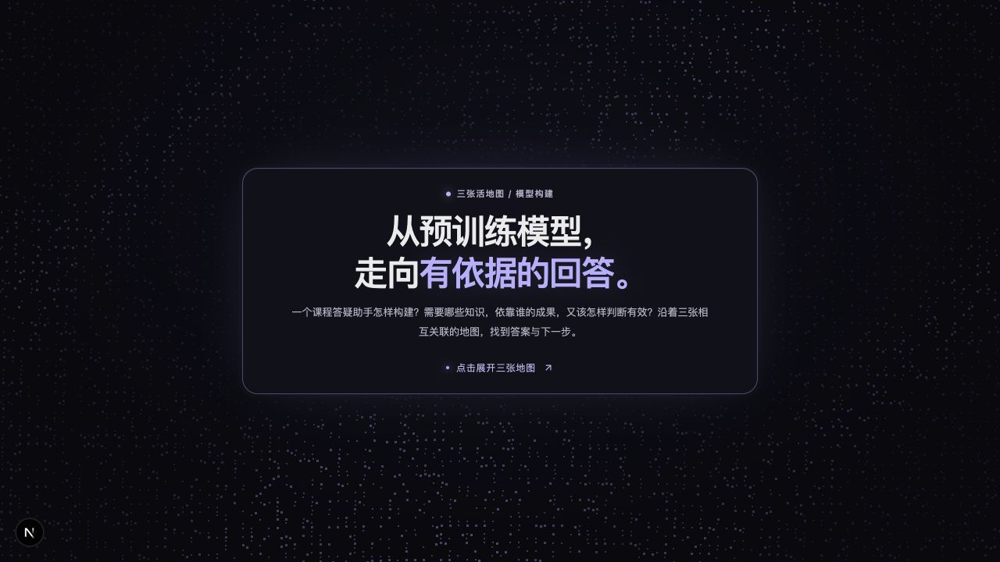
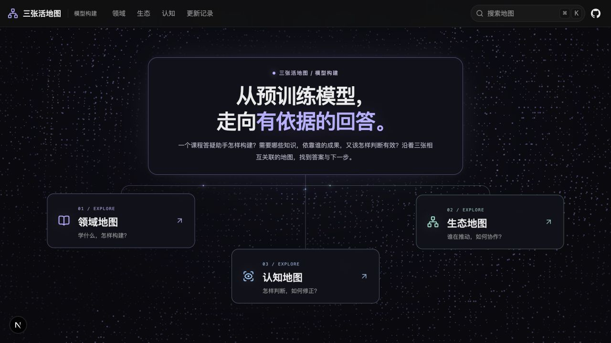

### 2. 领域地图与LoRA阅读

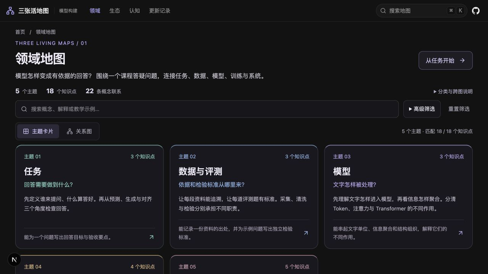
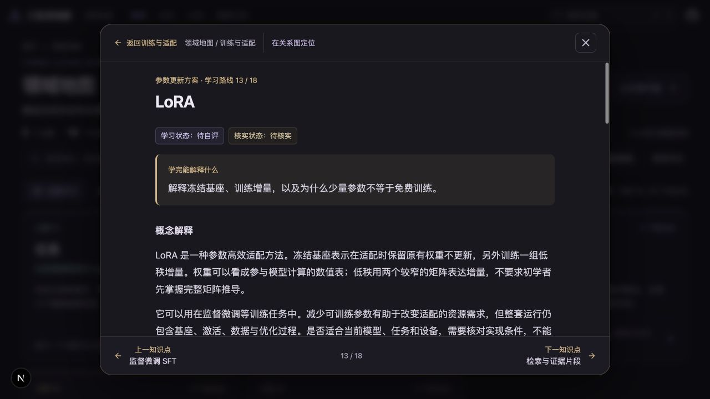
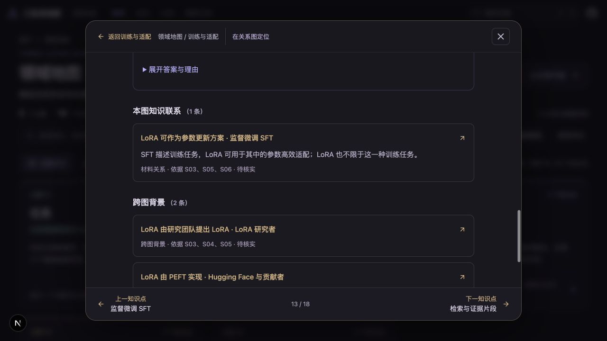

### 3. 定位操作与关系图

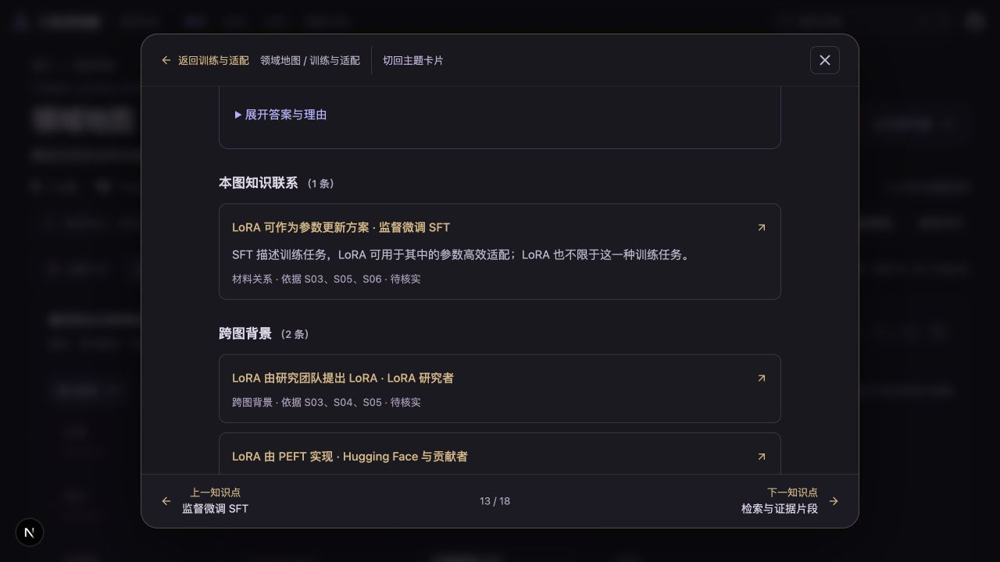
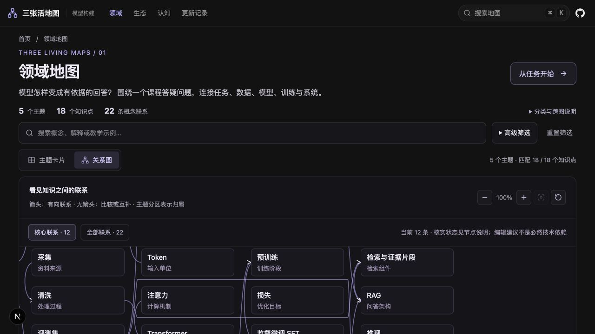

### 4. 生态地图与团队卡

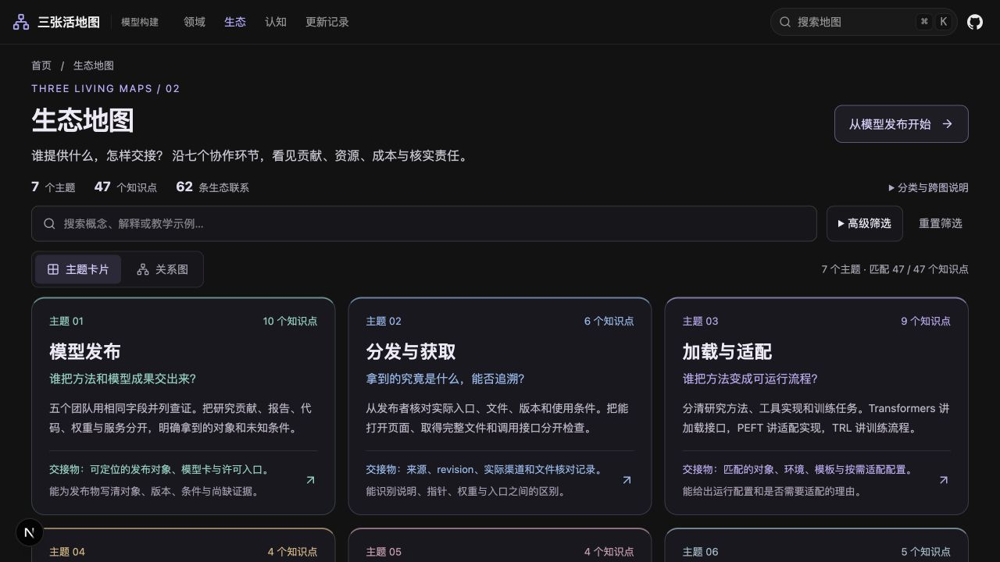
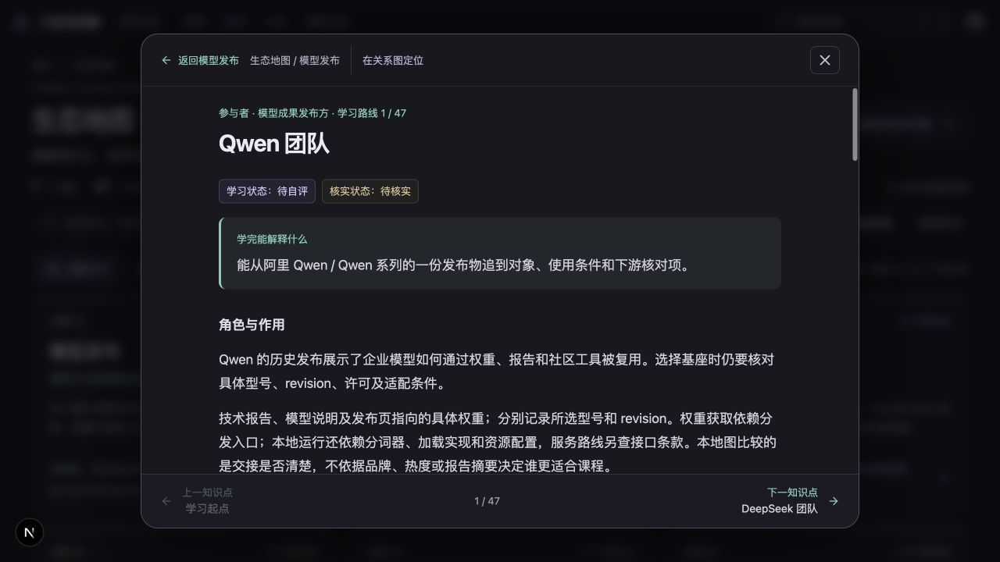

### 5. 认知地图与损失案例

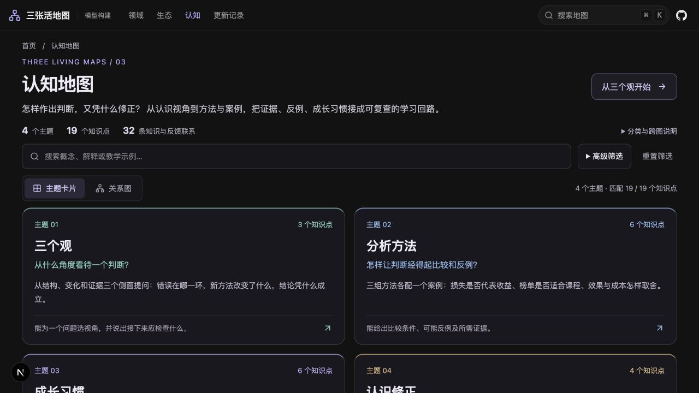

### 6. 展开理解检查

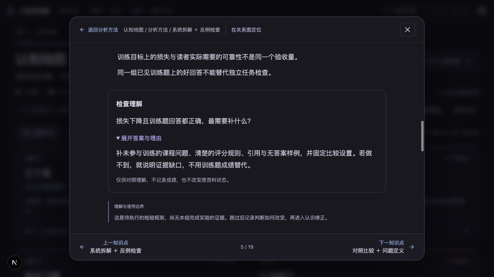

### 7. 全站检索

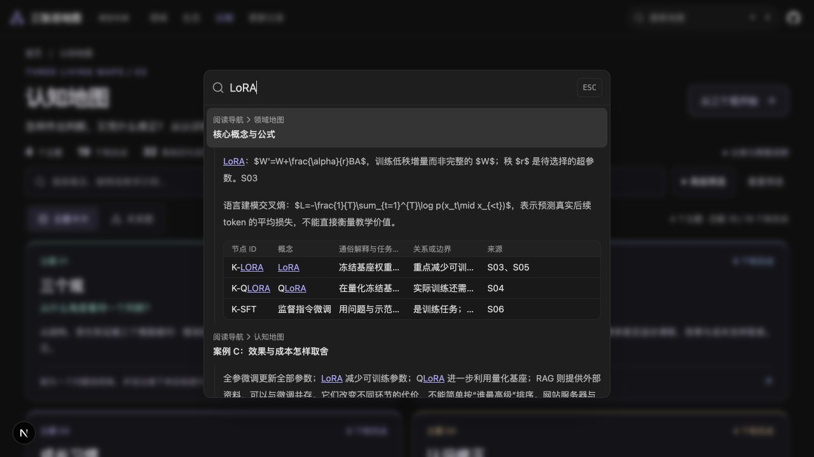

### 8. 搜索落到文章

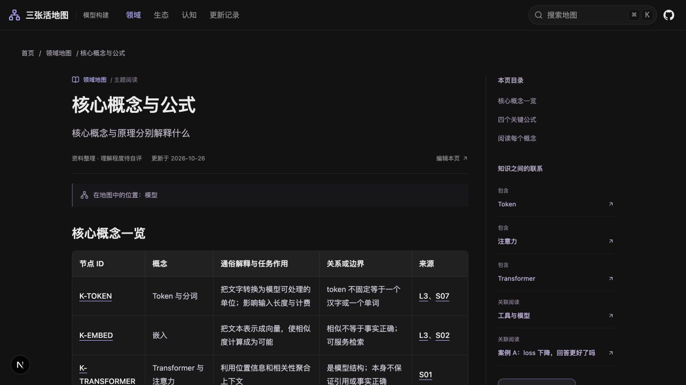

### 9. 公开更新与项目状态

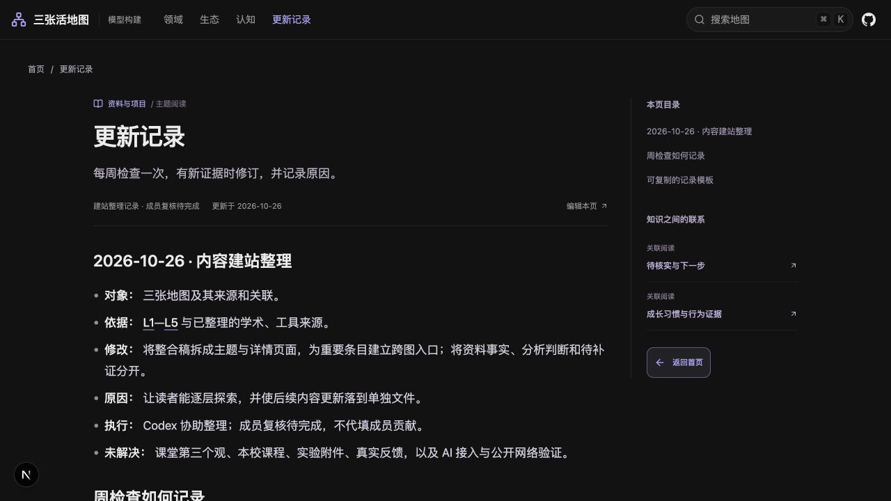
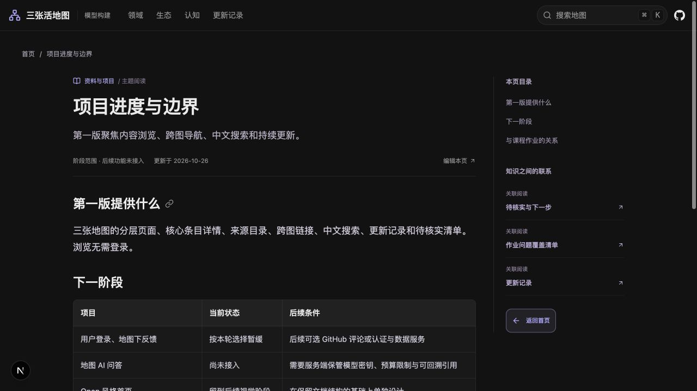
